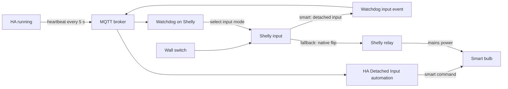

# Shelly wall switches, smart bulbs, and HA fallback

A wall switch is connected to a Shelly input; the Shelly relay supplies mains
power to a smart bulb. Home Assistant normally controls the bulb over its smart
protocol. If HA or the MQTT connection fails, the Shelly changes to native input
control so the wall switch can toggle mains power locally.

The central rule is that **the Shelly decides which path handles a press**.
HA receives dedicated input events only while the watchdog has confirmed smart
mode. In fallback, the device handles the input directly and sends no such events.

## The parts and their responsibilities

| Part | Responsibility | Source |
| --- | --- | --- |
| Smart Bulb Relay integration | Pairs relay and bulb, publishes HA heartbeats, exposes requested mode and device diagnostics | [`__init__.py`](../custom_components/smart_bulb_relay/__init__.py), [`switch.py`](../custom_components/smart_bulb_relay/switch.py) |
| Ansible `shelly_input_mode` role | Renders and installs the `ha-watchdog` script, configures managed channels and timing defaults | `roles/shelly_input_mode/` in the Ansible configuration repository |
| Shelly watchdog script | Checks the heartbeat lease and manual override, changes input modes, sends smart input events | `templates/ha-watchdog.js.j2` in that role |
| Detached Input blueprint | Handles accepted smart input events and controls the paired bulb, with relay recovery when needed | [shelly-detached-input.yaml](https://github.com/pschmitt/home-assistant-blueprints/blob/main/shelly-detached-input.yaml) |
| MQTT broker | Carries heartbeat and input messages; HA and the Shelly must both connect to it | Existing MQTT configuration |
| Smart bulb | Illuminates after mains power is restored when its power-on behavior is set to **On** | Bulb's device settings |

Keep its script name `ha-watchdog`: HA locates the script by that name for
diagnostics. The script must be enabled on boot. Its configured healthy input mode is
`detached`; the current lighting setup uses `flip` as the fallback mode. In
`flip`, either physical switch edge toggles the relay, regardless of switch
position. Multi-channel devices configure each managed channel separately.



## Normal operation

1. HA's integration publishes a heartbeat every five seconds, only while HA is
   running and its MQTT client is connected. Publication starts automatically;
   there is one publisher for the integration, rather than one per pairing.
2. After sufficient fresh heartbeats, the watchdog confirms that all its managed
   channels have the healthy input mode. A detached input leaves relay power
   under explicit control, keeping the bulb powered during normal smart use.
3. A physical input change produces an MQTT event only if the watchdog is in
   confirmed `smart` mode, its lease is still fresh, no mode change is in progress,
   and that channel's actual input mode is still `detached`.
4. The blueprint handles this event. With the watchdog topic configured, its old
   binary-sensor state trigger is disabled. HA therefore does not also act on
   the raw input state while native fallback is active.

Input messages contain the physical input state, not a requested bulb state.
Each edge is treated as a toggle. Duplicate status reports without an input
state change are suppressed by the script.

### How the blueprint handles a bulb

The built-in action uses the light entity when available. It turns the relay on
first if the circuit is unpowered. A later press can use normal smart control
once the bulb is reachable again.

If the light is unavailable, an optional power-based **Smart Bulb Status** sensor
helps distinguish a lit bulb from one drawing only standby power. Depending on
relay state and that sensor, the blueprint powers the circuit, cuts power to
turn it off, or power-cycles it to recover an unresponsive bulb. This sensor
estimates whether the bulb is lit; it does not prove smart-protocol reachability.

For normal smart commands, the blueprint waits for the requested light state
or matching power-sensor state. Its default confirmation timeout is one second.
An unconfirmed on command triggers a relay power cycle; an unconfirmed off
command cuts relay power. The default blueprint power-cycle delay is 800 ms.
An optional custom action replaces the normal smart-toggle sequence and its
confirmation/recovery step when the light is available and the relay is on.

The integration's separate `turn_on`, `turn_off`, and `toggle` services have their
own implementation and defaults, including a two-second power-cycle delay.
Changing a blueprint input does not change those service defaults.

## Losing HA and recovering

| Setting or event | Default | Purpose |
| --- | --- | --- |
| Heartbeat publication | Every 5 s | Provides repeated evidence that HA's publisher and MQTT path are working |
| Heartbeat expiry | 20 s after the last accepted heartbeat | Tolerates a few missed messages before detaching HA from input handling |
| Device timer | Every 1 s | Checks lease expiry and retries unsuccessful mode changes |
| HA shutdown message | `offline` on the heartbeat topic | Revokes the lease without waiting for expiry when graceful shutdown reaches the publisher |
| HA MQTT will | `offline` on `homeassistant/status` | Also revokes the lease when that message arrives; broker detection can take time |
| Shelly MQTT disconnect | Connection callback | Revokes the lease as soon as the device sees disconnection |
| Stable recovery | Heartbeats spanning at least 15 s | Prevents a single successful message from returning the input to detached mode |
| Mode reconciliation | Every 30 s | Repairs configuration drift without repeatedly writing unchanged settings |
| Manual override polling | Every 1 s | Picks up the persisted request without restarting the script |
| HA diagnostics polling | Every 15 s | Reports device state; this poll does not decide who handles a press |

If heartbeats simply stop, native fallback normally takes effect about 20–21
seconds after the last accepted message, plus the time needed to apply the
configuration. Presses during detection or a mode transition can be missed.
Disconnect and offline notifications can shorten this interval.

The device starts in native fallback while restoring the manual override and
waiting for a lease. Returning from fallback requires distinct heartbeat values
whose arrival times span at least 15 seconds, with the lease remaining fresh.
The first heartbeat may arrive up to five seconds after HA is running.

Lease age and recovery timing use **device uptime**. The Unix timestamp in the
heartbeat serves as a changing value; it is not compared against the Shelly's
wall clock. This avoids rejecting heartbeats when NTP clocks differ. One retained
or repeatedly delivered heartbeat value alone cannot establish smart mode.

Mode changes are applied one channel at a time and read back before success is
recorded. A failed RPC or mismatched readback leaves an error and is retried by
the timer. The script also checks the actual mode before sending a press event.

### Handover preserves relay output

Switching between `detached` and `flip` changes who handles the input. It does
not issue a relay on/off command. A circuit left off during fallback stays off
when HA returns; recovery does not unexpectedly illuminate a room. The next
intentional press or command can restore power and then smart control.

Set bulb power-on behavior to **On** for useful mains switching during an outage.
If a bulb restores its previous logical off state, restoring mains alone may
leave it dark. Even with **On**, a bulb that was logically off when HA failed may
need an off/on relay cycle: the first offline press cuts power, and the next
restores it. Fallback cannot inspect or change the bulb's smart state.

## Requested mode and actual mode are different

The HA **Smart Mode** switch expresses the manual request:

- **On:** allow smart mode when the heartbeat lease qualifies.
- **Off:** force native fallback regardless of HA health.

The persistent Shelly KVS key is `ha-watchdog-force-fallback`, using the strings
`"true"` and `"false"`. A missing key means smart mode is requested. Other KVS
read failures retain the last known request; before a successful initial read,
the script keeps native control. Changing the request does not restart the
watchdog. Clearing a forced fallback starts a new recovery period.

A smart-mode switch can therefore be **On** while its device is automatically
in fallback. Inspect its attributes for the actual state:

| `watchdog_mode` | Meaning |
| --- | --- |
| `starting` | Initializing, changing modes, or awaiting reconciliation of a changed target |
| `smart` | Managed channels are confirmed in their healthy modes and the watchdog has a qualifying lease |
| `fallback` | Native fallback is confirmed because a qualifying lease is absent |
| `forced` | Native fallback is confirmed because the manual override is active |
| `error` | A mode/configuration check failed, or HA could not obtain valid v2 status from a running script |

`heartbeat_age` is seconds since the last accepted heartbeat, or null after a
lease reset/before the first heartbeat. `watchdog_channels` lists each managed
channel's actual `in_mode`. The attributes are polled and can lag behind device
changes. Input ownership is decided locally on the device, independently of
these attributes.

The blueprint blocks events when its optional Smart Mode switch is explicitly
Off. For watchdog MQTT events, Unknown/Unavailable does not block an otherwise
valid event: the device's confirmed ownership is authoritative. Legacy input
state events require that optional switch to be On when it is supplied.

An HA automation can override the manual request by calling `make_all_smart`.
Check local startup automations before assuming a forced override survives an
HA restart. The KVS flag itself survives device/script restarts.

## Message contract

| Topic | Payload | Delivery |
| --- | --- | --- |
| `homeassistant/shelly-watchdog/heartbeat` | Unix timestamp as a JSON number, or literal `offline` on shutdown | QoS 0, not retained |
| `homeassistant/status` | HA's birth/will messages; only `offline` revokes the lease | Existing HA MQTT settings |
| `<Shelly MQTT topic_prefix>/ha-watchdog/input/<channel>` | `{"state":true,"mode":"smart"}` or the equivalent with `false` | QoS 0, not retained |

Input events use QoS 0 and no retain to avoid replaying old presses after a
reconnect. This favors avoiding duplicate toggles over guaranteed delivery of
every press. Do not add retained input publications or a second automation that
also toggles the same bulb from the raw Shelly input state.

Ansible exposes `shelly_ha_watchdog_heartbeat_topic`,
`shelly_ha_watchdog_status_topic`, `shelly_ha_watchdog_heartbeat_timeout_s`,
`shelly_ha_watchdog_recovery_s`, and `shelly_ha_watchdog_reconcile_s`.
The HA publisher's heartbeat topic and five-second cadence are currently code
constants. Changing only the device's heartbeat topic will break the lease;
change both ends together. Set the status topic to match HA if its MQTT will
configuration is customized.

## Configuration and rollout

For a managed channel, Ansible uses:

```yaml
shelly_config:
  inputs:
    - id: 0
      watchdog:
        enable: true
        healthy_mode: detached
        fallback_mode: flip
```

In the corresponding blueprint automation, set `watchdog_event_topic` to the
actual device MQTT prefix plus `/ha-watchdog/input/0`. Other inputs still select
the physical input entity, relay, target light, optional power-status sensor,
and Smart Mode switch. A two-channel Shelly may use channel 1 instead; the
number must match the channel configured in the script.

The default `homeassistant/shelly-watchdog/unused` selects the legacy state
trigger. Setting a real topic enables MQTT events and disables that legacy
trigger. A v1 watchdog does not publish the v2 events.

When adopting v2, prepare the matching integration, blueprint and topic settings,
then install the device scripts in a planned handover. The HA configuration must
be loaded and each device must run v2 before that circuit can use the new smart
input path. The Ansible entrypoint is `shelly-setup.yaml`, with the `input` tag
for the watchdog/input role; configure device MQTT first. Expect a short interval
of native control or unhandled smart input while the pieces are being updated.
Record current relay outputs and verify that handover preserves them.

Do not stop at a successful upload: check that `ha-watchdog` is enabled on boot,
running without script errors, receiving heartbeats, and eventually reporting
`smart`. The device interpreter has stricter syntax requirements than Node;
explicit semicolons are needed in this script. A Node simulation does not replace
checking that the uploaded code actually runs on the device.

## Troubleshooting

| Symptom | Check |
| --- | --- |
| Smart Mode is On but actual mode stays `fallback` | HA running state, MQTT connectivity at both ends, heartbeat topic agreement and `heartbeat_age`; allow the recovery period |
| `heartbeat_age` stays null | Heartbeats have not been accepted since the last reset; check publisher, broker access and topic |
| Mode stays `forced` | Read the force-fallback KVS flag; confirm the HA switch targets this Shelly |
| Mode reports `error` | Inspect `Script.List`, `Script.GetStatus`, channel IDs and actual `Switch.GetConfig`; also check HA's direct HTTP access to the device |
| Native switch works but smart presses do nothing | Match the blueprint topic to the device's actual prefix and channel, check the automation is enabled, and check the optional Smart Mode switch is not Off |
| A press appears to toggle twice | Look for another raw-input automation, duplicate MQTT publishers or an old watchdog still sending to the same topic |
| Restoring power leaves the bulb dark | Check bulb power-on behavior and try an intentional off/on cycle |
| HA shows old diagnostics | Allow its 15-second poll interval; inspect the device directly if necessary |

For direct status, find the `ha-watchdog` script ID with `Script.List`, then call
`Script.Eval` with:

```json
{"id": 1, "code": "JSON.stringify(watchdogStatus())"}
```

Replace `1` with the discovered script ID. `Script.GetStatus` reports whether it
is running and any interpreter errors. Do not assume the script ID equals the
input/relay channel number.

Live watchdog status stays in RAM and is read through `Script.Eval`; it is not
written to KVS every second. The manual override is the only KVS state used here.
This avoids frequent flash writes and avoids presenting persisted status from a
stopped script as current health.

## What this can detect

The heartbeat checks HA's running state and the MQTT delivery path. It does not
acknowledge each press, prove that the specific automation is enabled, or test
every bulb, Zigbee coordinator, or integration. The blueprint's bulb and power
checks handle some failures beyond that lease.

Native fallback still depends on a powered Shelly, the electrical circuit, and
a running watchdog that can change the input configuration. If the script itself
stops while the input is detached, it cannot switch that input back to native
mode. Inspect/restart the script or select native input mode through device
management; there is no independent script supervisor implemented here.

## Verification

After a planned HA restart, verify that each managed controller enters native
fallback and later recovers to smart mode, with relay outputs unchanged in both
transitions. Separately exercise physical switches and bulb recovery: inspecting
mode alone does not prove that every wall switch and bulb behaves as intended.

The Ansible repository also contains `tests/shelly-ha-watchdog.cjs`, which
simulates boot, lease expiry, repeated/malformed heartbeats, recovery, RPC
failure/retry, KVS override failures, configuration drift, disconnect and input
ownership. HA template checks covered acceptance of valid smart events and
rejection of fallback, malformed and native-state events.
